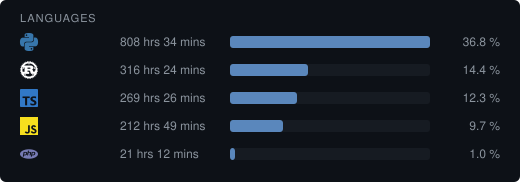
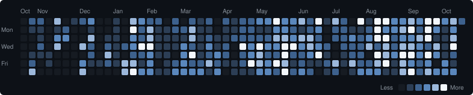

Hi, Semjon aka ryleq from Germany

I am a full stack dev and love Python. 

My favorite programming languages are:

- Python
- Rust
- JS/TS

if my commit history looks thin, that's not because i'm not coding, it's because i have a *very* particular workflow: 

I write an entire project locally, let it marinate, and then push it all in one massive single commit.

The wakatime numbers tell the real story:

<!--WAKATIME:START-->
**Total:** 2,197 hrs 11 mins · **Daily average:** 3 hrs 20 mins

<!--WAKATIME:END-->

Click the heatmap to hover over single days.

Here is a fun project I have built: [valstats.site](https://valstats.site/)
-> It's a very advanced VALORANT Tracker 

Currently I am writing a "VALORANT wrapped" project where users can see their VALORANT behaviour through an open-source data collector running in the background.

discord handle: **@ryleq**
