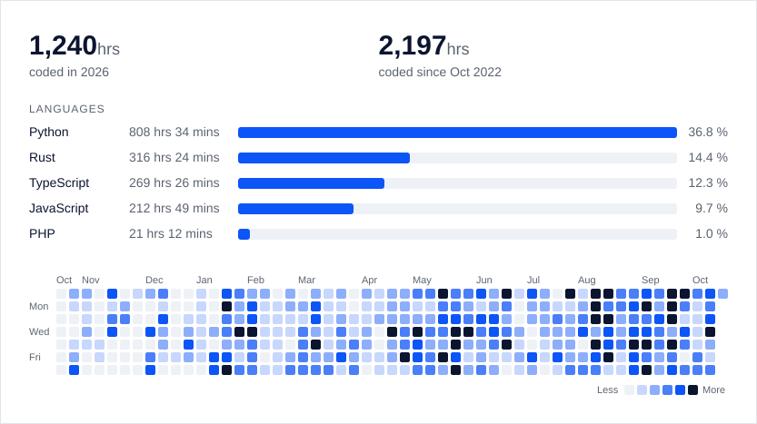

Hi, Semjon aka ryleq from Germany

I am a full stack dev and love Python. 

My favorite programming languages are:

- Python
- Rust
- JS/TS

if my commit history looks thin, that's not because i'm not coding, it's because i have a *very* particular workflow: 

I write an entire project locally, let it marinate, and then push it all in one massive single commit.

The wakatime numbers tell the real story:

<a href="https://wakatime.com/@ryleq">
  <picture>
    <source media="(prefers-color-scheme: dark)" srcset="assets/wakatime-dark-449f6d49d2.svg">
    
  </picture>
</a>

Here is a fun project I have built: [valstats.site](https://valstats.site/)
-> It's a very advanced VALORANT Tracker 

Currently I am writing a "VALORANT wrapped" project where users can see their VALORANT behaviour through an open-source data collector running in the background.

discord handle: **@ryleq**
